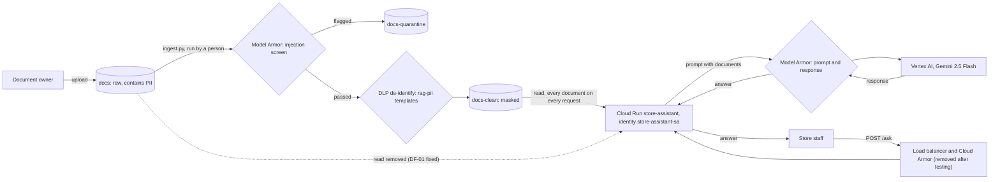

# AI Data Flow Review

**Prepared by:** Robert Bogan, security architecture

> **This is a pilot on a fictitious retailer, built in a personal lab.** It does not describe any real organization's environment.

## Summary

Source documents containing personal data are screened and masked before the model sees them, and the app reads only the masked copy. Two gaps undercut that. The app's identity can still read the raw, unmasked bucket, and the app falls back to that bucket if its configuration is missing. Together they meant one bad redeploy would send unmasked data to the model with no error. The raw-bucket grant was removed the same day (DF-01). Ingestion also runs by hand under a person's credentials.

All facts below were checked against the deployed configuration and source code on 2026-10-14.

## Diagram

## Hops

| # | From and to | Data | Identity | Controls | Gaps |
|---|---|---|---|---|---|
| 1 | Owner to raw bucket | Source documents, including PII and an injected vendor file | Person uploading | Google-managed encryption | Every project Viewer can read it (DF-02). Reads are not logged (LG-01). |
| 2 | Raw bucket to ingestion | Full raw text | The operator's own gcloud credentials | Runs on a workstation | Manual, person-run, raw PII passes through a laptop (DF-03) |
| 3 | Ingestion to quarantine | Documents flagged for prompt injection | Same | Model Armor injection filter | Whole-file quarantine also drops legitimate content (F5-03) |
| 4 | Ingestion to clean bucket | Masked text | Same | DLP inspect and de-identify templates | None found |
| 5 | User to Cloud Run | Question in a POST body | None. No user login. | Ingress limited to internal and load balancer traffic (AC-10). Cloud Armor and rate limit when the load balancer is deployed. | No user authentication. Prompts are not logged (LG-06). |
| 6 | Clean bucket to Cloud Run | Every masked document, on every request | store-assistant-sa, object reader | Masked data only | No retrieval scoping. Every user gets content from every document (DF-05). |
| 7 | Raw bucket to Cloud Run | None | Object reader removed 2026-10-14 | Denied when tested as the app identity | DF-01 resolved |
| 8 | Cloud Run to Model Armor to Vertex AI and back | Assembled prompt and model response | store-assistant-sa, Vertex AI user | Model Armor template (AC-02). Floor setting on template changes (AC-03). | Screening results not logged (LG-02). Guardrail turns off if its setting is missing (DF-04). |

## Findings

### DF-01 The app identity can still read the raw, unmasked bucket (HIGH)
store-assistant-sa holds object reader on the raw docs bucket as well as docs-clean. The raw grant dates from Module 2 and was not removed when Module 5 moved the app to the clean bucket. With DF-04, a redeploy that drops DOCS_BUCKET would send unmasked personal data to the model, and nothing would report an error. The identity had three grants, not the two recorded in Module 2.

**Resolved 2026-10-14.** The raw-bucket grant was removed in Terraform (module2-iam). Tested as the app identity, listing the raw bucket was denied for storage.objects.list, and the bucket policy no longer lists the account. The clean-bucket grant is unchanged in module5-dlp. A gcloud listing of the clean bucket was blocked by a quota-project permission the CLI requires and the app does not use, so the app's clean read was confirmed from configuration, not a live request.

### DF-02 Every project Viewer can read raw and quarantined data (MEDIUM)
Default legacy bindings give the project's Viewer role read access to every bucket, including raw PII and quarantined documents. Read-only access granted to the project for any purpose exposes the source data.

### DF-03 Ingestion runs by hand under a person's credentials (MEDIUM)
ingest.py uses the operator's gcloud token on a workstation. Raw personal data passes through a laptop, the actions are attributed to a person rather than a pipeline, and new documents are not screened or served until someone runs the script.

### DF-04 The app fails open when its configuration is missing (MEDIUM)
DOCS_BUCKET defaults to the raw bucket. MA_TEMPLATE defaults to empty, which turns Model Armor off (the F7-05 path, confirmed in source). Both should fail closed: refuse to start without them.

**Resolved 2026-10-14 (Module 8).** The app now refuses to start without its settings, and with gunicorn --preload a revision missing the guardrail setting is rejected at deploy while traffic stays on the last good revision. The first attempt without --preload was marked healthy by the platform (F8-01).

### DF-05 Every document goes into every prompt (MEDIUM, design)
There is no retrieval step. Each request sends the full masked corpus to the model, so any user can draw on any document. With documents scoped to different audiences, this would be oversharing (OWASP LLM08).

**Addressed in Module 8.** Retrieval now filters to the caller's entitlements before ranking. Tested with two personas. Remaining gap: no relevance threshold (F8-03).

### DF-06 RAG data is outside the key and perimeter controls tested elsewhere (LOW, lab design)
The customer-managed key was tested on a separate bucket, and docs-clean uses Google-managed encryption. VPC Service Controls were tested on separate organization projects. The app project sits outside the organization (F7-07).

## Recommended backlog

| Priority | Item | Closes | Effort | Needs approval from |
|---|---|---|---|---|
| 1 | Remove store-assistant-sa read access on the raw bucket, in Terraform | DF-01 | Done 2026-10-14 | Platform owner |
| 2 | Make the app refuse to start without DOCS_BUCKET and MA_TEMPLATE | DF-04 | Done 2026-10-14 | Application owner |
| 3 | Remove legacy Viewer bindings on raw and quarantine buckets | DF-02 | Low | Platform owner |
| 4 | Run ingestion as a dedicated service account, triggered on upload | DF-03 | Medium | Platform owner |
| 5 | Add retrieval scoped to the user's entitlements | DF-05 | Done in lab (Module 8) | Architecture review |
| 6 | Move the app into the organization, inside a perimeter, with CMEK on docs-clean | DF-06, F7-07 | Medium | Platform owner |

**Decision owner:** [Security leadership]
**Status:** Awaiting decision
